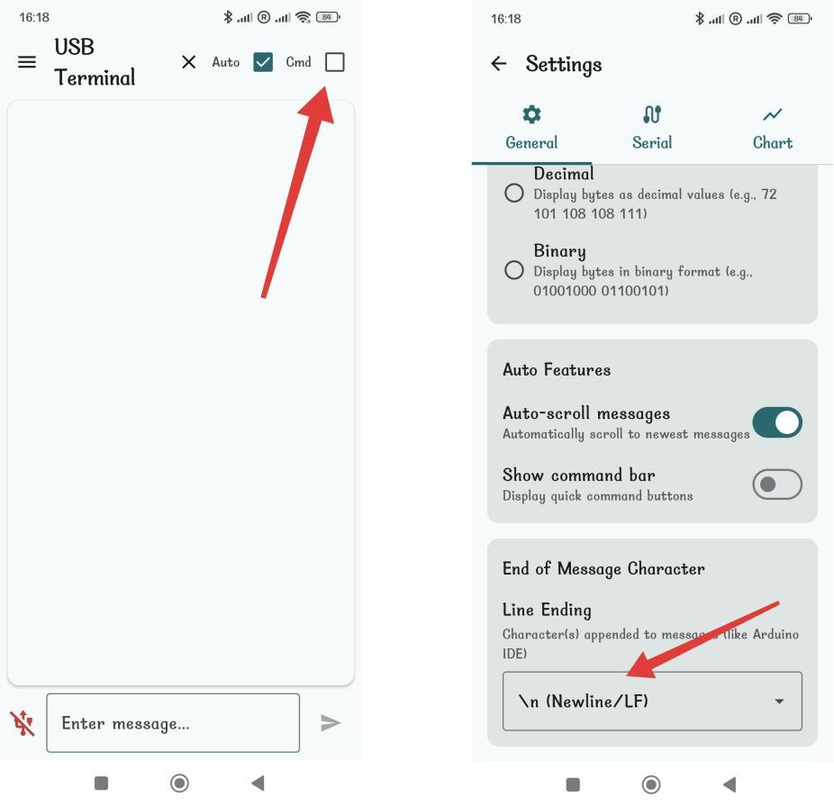
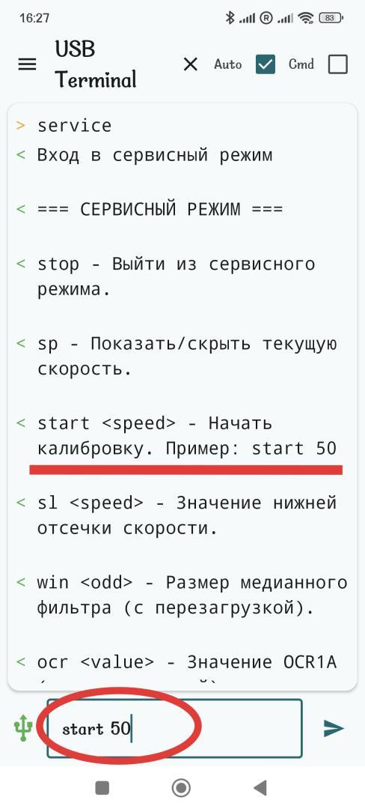
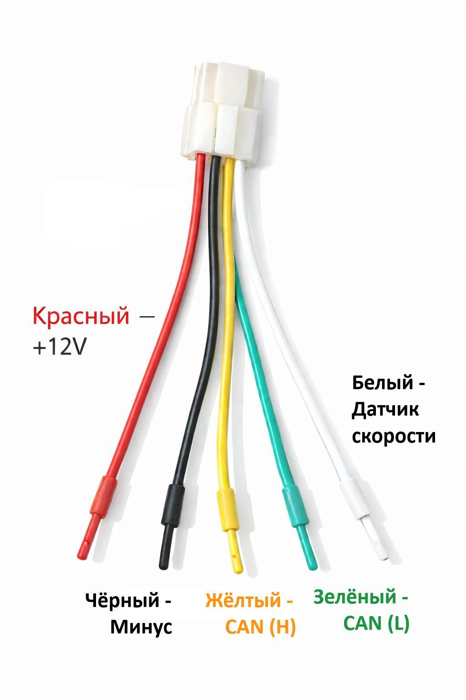

# Сервисный режим устройства CAN Speed Sensor

## Назначение сервисного режима

Сервисный режим предназначен для:

- настройки параметров работы датчика скорости;
- калибровки скорости;
- просмотра текущего значения скорости.

Для работы с сервисным режимом требуется установить UART-соединение с устройством.

## Подключение с телефона (Android)

Для подключения через телефон рекомендуется использовать приложение **Open Accessory Terminal** (доступно в Google Play).

### Порядок подключения

1. Подключите устройство к телефону с помощью USB кабеля.
2. Запустите приложение **Open Accessory Terminal**.
3. Установить настройки как показано на фото: убрать галочку **Cmd** и установить **`\n Newline/LF`**.

## Вход в сервисный режим

1. Подключите устройство к телефону через USB.
2. Откройте **Open Accessory Terminal** (или любой терминал).
3. Отправьте команду: `service`.

После входа в сервисный режим в терминал выводится список доступных команд и текущие параметры.

## Общий список команд сервисного режима

| Команда | Назначение |
|---|---|
| `stop` | Выход из сервисного режима |
| `sp` | Показать / скрыть текущую скорость |
| `start <speed>` | Калибровка коэффициента скорости |
| `sl <value>` | Нижняя отсечка скорости |
| `win <odd>` | Размер окна медианного фильтра |
| `ocr <value>` | Значение OCR1A таймера |

## Команда `stop` — выход из сервисного режима

**Назначение:** выход из сервисного режима и возврат устройства в обычный режим работы.

**После выполнения:** устройство работает с сохранёнными настройками.

## Команда `sp` — отображение текущей скорости

**Назначение:** включает или выключает периодический вывод текущей скорости в терминал.

**Поведение:**

- скорость выводится каждые **250 мс**;
- отображается итоговое значение скорости.

Повторный ввод команды **SP** выключает отображение.

## Команда `start <speed>` — калибровка скорости

**Назначение:** запуск калибровки коэффициента скорости (`speedCoef`). Обязательная процедура. Выполняется 1 раз после установки устройства.

### Как работает калибровка

1. Укажите скорость автомобиля (в км/ч), на которой будет производиться калибровка.
2. Наберите эту скорость и отправьте команду `start <выбранная скорость>`.
3. Удерживайте эту скорость примерно **5 секунд**.
4. Устройство автоматически сделает 10 измерений, вычислит среднее значение и пересчитает коэффициент скорости.

**Пример:** `start 50` — запустит калибровку с расчётной скоростью 50 км/ч.

## Команда `sl <value>` — нижняя отсечка скорости

**Назначение:** устанавливает минимальную скорость, ниже которой по CAN передаётся **0 км/ч**.

**Диапазон значений:** 2 … 250 км/ч.

**Пример:** `sl 20`.

**Результат:**

- скорость ниже 20 км/ч будет передаваться в CAN как 0 км/ч;
- применяется сразу, без перезагрузки.

## Команда `win <odd>` — размер медианного фильтра

**Назначение:** задаёт размер окна медианного фильтра для сглаживания сигнала скорости. Применяется для не стабильных источников сигнала, где присутствуют значительные шумы сигнала. Чем больше значение — тем больше подавление шумов, но больше инерция в обработке.

Для большинства датчиков или штатного сигнала оптимальное значение **5 или 7**.

**Требования:**

- значение должно быть **нечётным**;
- диапазон: **3 … 21**.

**Пример:** `win 7`.

**Важно: требуется перезагрузка устройства для применения.**

## Команда `ocr <value>` — скорость передачи данных в CAN

**Назначение:** команда `ocr` задаёт, с какой частотой устройство передаёт данные о скорости в CAN-шину: как часто в CAN отправляется значение скорости, с какой задержкой обновляются данные. **Не меняйте этот параметр без явной необходимости.**

### Важно

⚠ **Этот параметр предназначен для разработчиков.**

Если нет чёткого понимания:

- зачем изменять этот параметр;
- как его значение влияет на работу системы,

👉 **настоятельно рекомендуется не менять его и оставить значение по умолчанию.**

Неправильная настройка может привести к:

- слишком редкой передаче данных в CAN;
- излишне частой передаче сообщений;
- некорректной реакции системы на пропадание сигнала скорости.

**Диапазон значений:** 50 … 60000.

**Пример:** `ocr 3124`.

**Важно: применяется только после перезагрузки.**

## Текущие параметры

При входе в сервисный режим автоматически отображаются:

- текущий коэффициент скорости;
- нижняя отсечка скорости (`sl`);
- размер фильтра (`win`);
- значение OCR1A (`ocr`).

Это позволяет контролировать все настройки перед изменением.

## Рекомендации

- Меняйте **один параметр за раз**.
- После изменения **win** и **ocr** обязательно перезагружайте устройство.
- Калибровку выполняйте на ровной дороге с постоянной скоростью.
- Не используйте сервисный режим во время обычной эксплуатации.

## Подключение устройства

- Красный провод — на +12v.
- Чёрный провод — на минус.
- Зелёный провод — на L линию CAN шины.
- Жёлтый провод — на H линию CAN шины.
- Белый провод — на датчик скорости.

